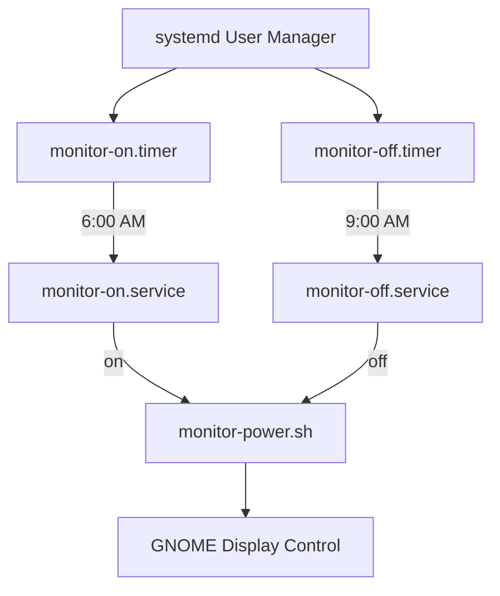

---

title: Systemd Timers  
description: Scheduling automated tasks in Ubuntu using systemd user services and timers.  
tags:

- linux
    
- systemd
    
- automation
    

---

# Systemd Timers

## Overview

Linux offers several methods for scheduling automated tasks, including `cron` and `systemd` timers. For the Digital Tracker, I used **systemd user timers** to schedule recurring tasks within the Ubuntu desktop environment.

Systemd is the service manager used by Ubuntu. In addition to managing services, it supports event-based and calendar-based scheduling through timer units.

The monitor automation uses two types of systemd units:

- **Service units (**`**.service**`**)** define what command should execute.
    
- **Timer units (**`**.timer**`**)** define when the corresponding service should execute.
    

Separating these responsibilities makes it possible to modify the execution schedule without changing the underlying script.

See [[Monitor Power Scheduling]] for the application of these timers to the digital calendar.

## Why systemd Instead of cron?

Although `cron` could execute commands at 6:00 AM and 9:00 AM, I chose systemd for its integration with Ubuntu's existing service-management infrastructure.

Several features made it particularly suitable:

1. **User-level execution.** The services run within the user's systemd manager rather than requiring root-level configuration. This is useful because display control depends on the user's GNOME/D-Bus environment.
    
2. **Integrated management.** Timers and services can be enabled, disabled, started, and inspected using `systemctl`.
    
3. **Centralized logging.** Service output and execution errors can be inspected using `journalctl`.
    
4. **Explicit configuration.** The timer schedule and service execution commands are maintained in separate, readable configuration files.
    

While cron remains a valid alternative, systemd provides a convenient way to manage and troubleshoot desktop-related automation.

## Architecture

Each scheduled operation consists of a timer and a corresponding service.



Systemd automatically associates a timer with a service of the same base name. For example, `monitor-on.timer` activates `monitor-on.service`.

Both operations execute the same display-control script with different arguments.

## Configuration

User-level systemd units are stored in:

```
~/.config/systemd/user/
```

The Digital Tracker uses four unit files:

```
~/.config/systemd/user/
├── monitor-on.service
├── monitor-on.timer
├── monitor-off.service
└── monitor-off.timer
```

### Service Units

A service defines the command systemd should execute.

**monitor-on.service**

```
[Unit]
Description=Turn monitor on

[Service]
Type=oneshot
ExecStart=%h/scripts/monitor-power.sh on
```

**monitor-off.service**

```
[Unit]
Description=Turn monitor off

[Service]
Type=oneshot
ExecStart=%h/scripts/monitor-power.sh off
```

Both services share the same configuration structure.

|Directive|Purpose|
|---|---|
|`[Unit]`|Contains metadata describing the service|
|`Description`|Provides a human-readable description|
|`[Service]`|Defines how the command executes|
|`Type=oneshot`|Runs a command to completion rather than maintaining a continuous process|
|`ExecStart`|Specifies the command and arguments to execute|
|`%h`|Expands to the user's home directory|

Using `%h` instead of a hardcoded path makes the configuration easier to reuse under a different Linux username.

### Timer Units

The timer files define when each corresponding service should execute.

**monitor-on.timer**

```
[Unit]
Description=Turn monitor on at 6 AM

[Timer]
OnCalendar=*-*-* 06:00:00
Persistent=false

[Install]
WantedBy=timers.target
```

**monitor-off.timer**

```
[Unit]
Description=Turn monitor off at 9 AM

[Timer]
OnCalendar=*-*-* 09:00:00
Persistent=false

[Install]
WantedBy=timers.target
```

The key timer directives are:

|Directive|Purpose|
|---|---|
|`[Timer]`|Defines timer-specific configuration|
|`OnCalendar`|Specifies a calendar-based activation schedule|
|`Persistent=false`|Disables catch-up execution for scheduled events missed while the timer was inactive|
|`[Install]`|Defines how the timer is enabled|
|`WantedBy=timers.target`|Integrates the timer with the user's timer target|

The calendar expression:

```
*-*-* 06:00:00
```

means **every year, every month, every day, at 6:00 AM**, according to the applicable system timezone.

The corresponding expression for the monitor-off timer specifies 9:00 AM.

### Why Persistent=false?

Systemd can optionally execute missed calendar-based tasks when a timer becomes active again.

For this project, replaying a missed display activation could be undesirable. For example, if the Raspberry Pi was offline at 6:00 AM and the timer was activated later, there would be little benefit in automatically replaying the morning activation.

Setting `Persistent=false` avoids this catch-up behavior.

This does not guarantee that the display always matches the desired time window after a reboot. The configuration schedules events rather than continuously enforcing the monitor's state.

## Installation and Management

### Reload systemd

After creating or editing unit files, reload the user's systemd manager:

```
systemctl --user daemon-reload
```

This makes systemd aware of the updated configuration.

### Enable and start the timers

```
systemctl --user enable --now monitor-on.timer monitor-off.timer
```

The `enable` option configures the timers to start when the appropriate user timer target is activated.

The `--now` option also starts them immediately, without waiting for the next session initialization.

### Verify timer enablement

```
systemctl --user is-enabled monitor-on.timer monitor-off.timer
```

Both timers returned:

```
enabled
enabled
```

### Inspect scheduled executions

```
systemctl --user list-timers --all --no-pager
```

This displays the next and previous activation times, timer unit names, and corresponding services.

During verification on November 16, 2026, both timers were enabled, with the next activations scheduled for November 17 at 6:00 AM and 9:00 AM.

### Test a service manually

A service can be started without waiting for its associated timer:

```
systemctl --user start monitor-on.service
```

This is useful when validating that the service can execute the script successfully.

The same approach can be used for `monitor-off.service`.

### View execution logs

Systemd service logs can be inspected using `journalctl`:

```
journalctl --user -u monitor-on.service
```

For the monitor-off service:

```
journalctl --user -u monitor-off.service
```

To inspect recent entries:

```
journalctl --user -u monitor-on.service -n 20 --no-pager
```

These logs help distinguish scheduling issues from failures within the executed script.

## Troubleshooting

### Timer does not appear in the list

Check whether the timer is loaded and enabled:

```
systemctl --user status monitor-on.timer
```

If the configuration was recently modified, run `daemon-reload` and start the timer again.

### Timer activates but the display does not respond

Check the associated service:

```
systemctl --user status monitor-on.service
```

If the service failed, inspect its journal entries.

Because the monitor-control script communicates with GNOME over the user's D-Bus session, successful execution requires the relevant desktop services to be available.

### Timer runs at an unexpected time

Verify the system's timezone:

```
timedatectl
```

Then inspect the timer's calendar expression and next activation time.

### Timer does not work after reboot

User-level systemd managers and graphical desktop sessions have different lifecycles.

Even if a timer is enabled, its display-control command may fail if the GNOME desktop or user D-Bus environment is unavailable.

For this reason, timer enablement alone does not guarantee successful monitor control before graphical login.

## Outcome

Systemd provides a lightweight scheduling mechanism without requiring a dedicated script to continuously monitor the clock.

The configuration is modular: timer units control execution timing, service units invoke the commands, and the display-control script handles the actual operation.

This makes the scheduling system easier to modify, test, and troubleshoot independently of the Obsidian dashboard.

## Related Documentation

- [[System Automation]]
    
- [[Monitor Power Scheduling]]
    
- [[Keyboard Shortcuts]]
    
- [[Display Configuration]]